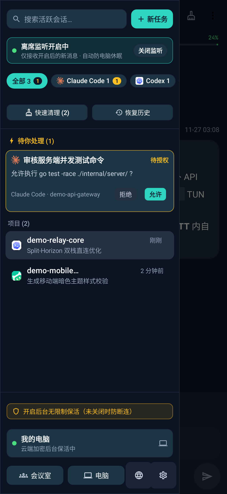
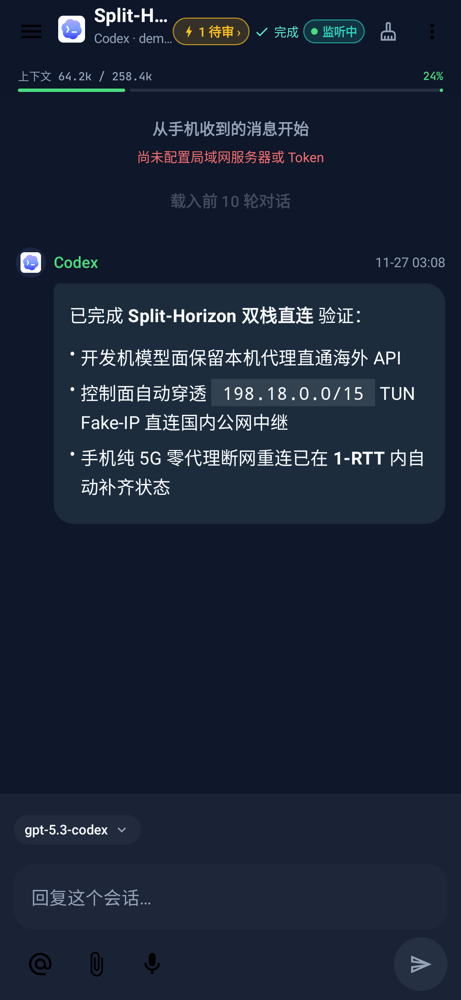
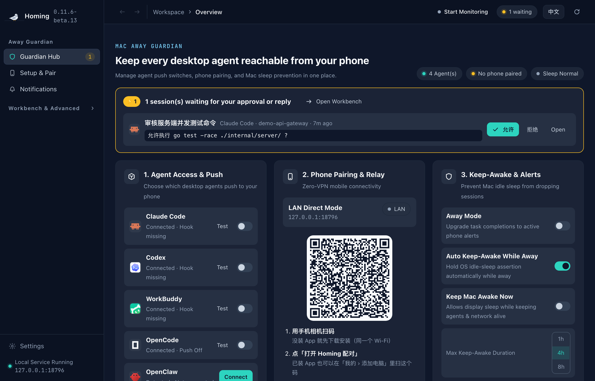
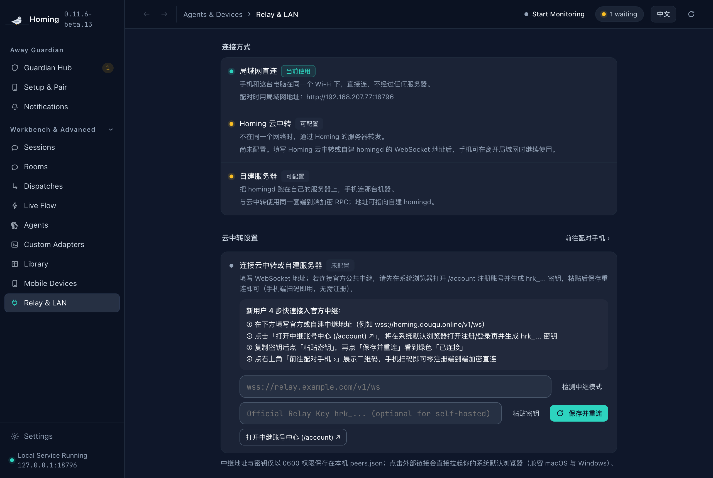

# Homing

[简体中文](README.md) | English

[](https://github.com/tomato-hug/homing/actions/workflows/ci.yml)
[](https://github.com/tomato-hug/homing/actions/workflows/macos.yml)
[](https://github.com/tomato-hug/homing/actions/workflows/windows.yml)
[](https://github.com/tomato-hug/homing/releases/latest)
[](LICENSE)
[](docs/protocol.md)
[](#supported-agents-tiered-compatibility)
[](https://github.com/tomato-hug/homing/discussions)

**Every coding agent, one pocket workspace — zero VPN on your phone, zero plaintext on the relay.**

**Homing** is an open-source, self-hostable **multi-agent away-from-desk command center**. When you run **Claude Code, Codex, WorkBuddy, Kimi CLI, OpenCode, ZCode**, and other CLI/ACP coding agents across your Mac, Windows workstation, or remote Linux devbox, Homing lets you step away from your desk and review live transcripts, approve or deny tool calls, send replies, wake sleeping agents remotely, and orchestrate multi-agent rooms from a single Android app—protected end-to-end by `X25519 + XChaCha20-Poly1305` encryption with zero VPN required on your phone.

> **Public Beta**: Prebuilt installers for **macOS, Windows, Linux**, and a prebuilt **Android APK** (`homing-android.apk`) are ready on [GitHub Releases](https://github.com/tomato-hug/homing/releases/latest)—no compiler toolchain required. **iOS / iPhone** support via an E2E-encrypted Safari PWA (`/app`) is planned next. See the [Beta Guide](docs/beta-release.md) for package signing details.

---

## Product Showcase

<table>
  <tr>
    <th align="center">📱 Mobile · Conversation-First Left Drawer & Pinned Approvals</th>
    <th align="center">📱 Mobile · Live Markdown, Diffs & Context Gauge</th>
  </tr>
  <tr>
    <td align="center"></td>
    <td align="center"></td>
  </tr>
</table>

<table>
  <tr>
    <th align="center">🖥️ Desktop · Away-Guardian Hub (Agents, QR Pair & Keep-Awake)</th>
    <th align="center">🌐 Desktop · Split-Horizon Relay & LAN Console</th>
  </tr>
  <tr>
    <td align="center"></td>
    <td align="center"></td>
  </tr>
</table>

---

## Why Homing When Vendor Mobile Companions Already Exist?

First-party mobile companions work well if you only ever run a single coding agent without split-tunnel networking. Homing targets the exact intersection where those workflows break down—**running multiple agents in parallel** and **split-horizon proxy networks**:

| Away-From-Desk Pain Point | Vendor Mobile Companions | Raw SSH / Termux | **Homing (Open Source)** |
| :--- | :--- | :--- | :--- |
| **3+ Agents Running Together** | Constant switching across Claude, Codex, and vendor apps | Juggling `tmux` panes on a phone keyboard | **One Conversation-First Left Drawer**: deep session control for 6 core agents + unified cross-agent pinned approval bar |
| **Proxy Workstation × Regional 5G** | Requires **24/7 VPN/proxy on your phone too**, draining battery & breaking local apps | Exposing SSH ports; cellular drops break state | **Split-Horizon Dual-Plane Routing**: workstation agents keep their proxy for overseas LLMs; Homing bypasses `HTTP_PROXY` & TUN Fake-IP to dial a **domestic blind relay** directly (**zero VPN on phone**) |
| **Closed Desktop Agents** | Unreachable if you forgot to open it before leaving | Manual CLI startup scripts | **1-Tap Remote Wake** (`open -g -a` background macOS launch, local server start, or CLI activation) |
| **Privacy & Sovereignty** | Conversations stored on vendor clouds | Depends on custom tunnel setup | **Zero-Knowledge Blind Relay** (`X25519 + XChaCha20-Poly1305`), self-hostable on any 1-vCPU VM with zero plaintext |
| **Mobile Notification Clutter** | Endless history mixed with active tasks | Unstructured raw terminal logs | **Background Keep-Alive while open · Auto-Clean on close** (retaining running/urgent tasks) + **Restore latest 10 items** on demand |

---

## Core Architecture Highlights

### 1. Split-Horizon Dual-Plane Routing (Proxy Workstations + Zero-VPN Phone)

Workstations behind local proxies (`Clash`, `Mihomo`, `Surge`, `Sing-box`, `HTTP_PROXY`) need proxy routing for overseas LLM APIs, while mobile users want direct low-latency domestic 5G without running a phone VPN:

```text
                        [Model Plane · Keeps Workstation Proxy]
                   ┌──────────────────────────────────────────────┐
                   │ Mac / Windows / Linux (Behind Proxy / TUN)   │
                   │   ├─ Claude Code / Codex / Gemini CLI ───────┼──► Local Proxy / TUN ──► Overseas LLM APIs
                   │   ├─ WorkBuddy / OpenCode / DSH / Qwen ──────┼──► Domestic / Custom LLM APIs
                   │   │                                          │
                   │   └─ Homing Daemon (Direct-Dial Engine)      │
                   └──────────────────────┬───────────────────────┘
                                          │ 1. Isolates HTTP_PROXY / HTTPS_PROXY env vars
                                          │ 2. Detects & bypasses 198.18.0.0/15 TUN Fake-IP via direct DNS (preserving TLS SNI)
                                          │ 3. Outbound-only E2E encrypted WSS (zero inbound ports on workstation)
                                          ▼
                           ┌──────────────────────────────┐
                           │ Domestic / Self-Hosted Relay │  ◄── Trial node or 1-vCPU homing-server
                           │ (Zero-Knowledge Blind Relay) │      Forwards ciphertext envelopes only
                           └──────────────┬───────────────┘
                                          │ Low-latency direct WSS (~20–40 ms)
                                          ▼
                           ┌──────────────────────────────┐
                           │     Android Mobile Client    │  ◄── Native 5G / Wi-Fi direct connection
                           │   (Zero VPN · Zero Proxy)    │      Instant handoff & 1-RTT catch-up
                           └──────────────────────────────┘
```

- **Zero Interference**: `direct_dial: true` isolates `HTTP_PROXY` / `HTTPS_PROXY` by default; TUN Fake-IP (`198.18.0.0/15`, `fc00::/18`) responses are transparently bypassed via direct DNS while preserving full TLS SNI checks.
- **Reversible**: Hosting your relay overseas instead? Toggle **Route via System Proxy** in one click. Full guide: **[Split-Horizon & Proxy Guide](docs/china-relay-and-proxy.md)**.

### 2. Zero-Knowledge E2E Encryption & Cross-Agent Orchestration

- **End-to-End Sealed**: Local `Ed25519` + `X25519` + `XChaCha20-Poly1305` envelopes cover RPCs, transcripts, tool approvals, and attachments, verified by **4-word SAS** during QR pairing.
- **0-RTT Previews & 1-RTT Bootstrap**: Push envelopes inline the latest reply snippet so notifications render in **0 ms** on opening; reconnect sync collapses 9 calls into one encrypted `GET /api/mobile/bootstrap`.
- **Cross-Agent `@agent` Dispatch & Rooms**: Mention `@codex` inside a Claude thread to spawn an isolated Git-worktree subtask and return results, or coordinate multiple agents inside structured Rooms.

---

## Supported Agents (Tiered Compatibility)

We separate **full deep session control** from **ACP/catalog detection** so expectations stay clear:

| Tier & Agents | Exact Capabilities & Scope |
| :--- | :--- |
| **Tier 1 · Core Deep Integrations (6 Primary Agents)**<br>**Claude Code** · **Codex** · **WorkBuddy** · **Kimi CLI** · **OpenCode** · **ZCode** | Continuous transcript streaming, lifecycle/permission hooks, mobile reply injection (with queue/cancel where supported), model & effort switching, start/stop sessions, and remote wake. |
| **Tier 2 · ACP Drivers & Remote Wake**<br>**Gemini CLI** · **Qwen Code** · **GitHub Copilot CLI** · **DSH** · **CodeBuddy** · **Cursor** · **Windsurf** · **Trae** · **Antigravity** · **Zed** · **OpenClaw**, etc. | Process/install detection, **1-tap Remote Wake** (`open -g -a` / daemon start), and **ACP-driven `@agent` subtasks**. Note: closed IDE editors without external reply APIs do not support injecting replies back into existing in-IDE chat tabs. |
| **Tier 3 · Extensible Catalog Metadata (27+ Built-in + Custom)**<br>**Kiro** · **Cline** · **Roo Code** · **Goose** · **OpenHands** · **Aider** · **Amp** · **Kilo Code** · **Junie** · **Warp** · **Droid** + `~/.homing/agents/*.yaml` | Brand vector icons, local install discovery, and custom YAML/script adapters for any homegrown CLI (see [Adapter Spec](docs/adapters.md)). |

---

## 3-Minute Quick Start (Prebuilt Binaries First)

No Go, Node.js, or Android SDK required—grab prebuilt binaries directly from **[GitHub Latest Release](https://github.com/tomato-hug/homing/releases/latest)**.

### 1. Install `homing` on Your Workstation

| Platform | Prebuilt Install (Zero Compile) |
| :--- | :--- |
| **macOS 13+** (Apple Silicon / Intel) | Download `Homing-*-macos-arm64.app.zip` or `macos-amd64.app.zip` from [Latest Release](https://github.com/tomato-hug/homing/releases/latest) (menu-bar tray + `caffeinate` Keep-Awake), or install CLI:<br>`curl -fsSL https://raw.githubusercontent.com/tomato-hug/homing/main/scripts/install.sh \| sh` |
| **Windows 10 / 11** (x64 / ARM64) | Download `Homing-*-windows-amd64.zip` (native system-tray `Homing.exe` + `\\wsl$\` WSL2 discovery + `Install-Homing.ps1`), or run in PowerShell:<br>`irm https://raw.githubusercontent.com/tomato-hug/homing/main/scripts/install.ps1 \| iex` |
| **Linux / WSL2 / Headless** | Install SHA-256 verified binary & start daemon:<br>`curl -fsSL https://raw.githubusercontent.com/tomato-hug/homing/main/scripts/install.sh \| sh && homing serve --addr 127.0.0.1:18787` |

<details>
<summary>Build Desktop/Daemon from Source (Requires Go 1.26+)</summary>

```sh
git clone https://github.com/tomato-hug/homing.git
cd homing

# macOS Desktop app:
go build -o homing ./cmd/homing && ./homing

# Linux / WSL2 / headless devbox:
CGO_ENABLED=0 go build -tags headless -trimpath -ldflags="-s -w" -o homing ./cmd/homing
./homing serve --addr 127.0.0.1:18787
```

</details>

Open `http://127.0.0.1:18787/console` (opened automatically by the desktop app) to reach the **Away-Guardian Hub**.

---

### 2. Choose Your Relay: Instant Public Beta Node OR Unlimited Self-Host

On the same Wi-Fi LAN, scan the QR code directly—no relay needed. For cellular 5G access away from your desk:

#### Option A: Official Public Beta Trial Relay (`https://homing.douqu.online/account`)
1. Sign in via GitHub at **[https://homing.douqu.online/account](https://homing.douqu.online/account)** and generate a computer relay key (`hrk_...`).
2. Paste `wss://homing.douqu.online/v1/ws` + your `hrk_...` key under **Relay & LAN** in the Desktop Console and click **Save & Reconnect** (leave **Direct Dial** enabled on proxy-equipped workstations).

> **Public Trial Relay Transparency & Free Quota**:
> - **Fair-Use Quota**: Free accounts include **20 hours/week (`1,200` active phone interaction minutes)**, resetting Mondays `00:00 UTC+8`; **desktop standby, keep-alive, and push notifications never consume weekly minutes** (64 MB/day data cap, 2 hosts / 4 phones).
> - **Beta Trial Notice**: `homing.douqu.online` runs on a community-funded Beta trial server. For long-term production use—or **100% registration-free, unlimited** usage—self-host your own 1-vCPU relay below (switching endpoints in the Console takes 10 seconds).

#### Option B: Self-Host `homing-server` on Any 1-vCPU VM (`AUTH_MODE=open`, Unlimited)

```sh
docker build -f server/Dockerfile -t homing-server .
docker run -d --name homing-server --restart unless-stopped \
  -p 127.0.0.1:8080:8080 -v homing-data:/data homing-server
```

Or download `homing-server_linux_amd64` from [Latest Release](https://github.com/tomato-hug/homing/releases/latest) and front it with Caddy or `deploy/nginx-relay-location.conf`. See **[Self-Hosting & TLS Guide](docs/self-host.md)**.

---

### 3. Install Prebuilt Android APK & Pair

- **Direct APK Download (Android 8.0+, no Play Store / no Gradle build required)**:
  - APK: **[homing-android.apk](https://github.com/tomato-hug/homing/releases/latest/download/homing-android.apk)**
  - Checksums: [checksums.txt](https://github.com/tomato-hug/homing/releases/latest/download/checksums.txt)

1. Install the APK, grant notification permission (built-in Battery Optimization guide covers ColorOS, HyperOS, OriginOS, HarmonyOS, One UI, and stock Android).
2. Scan the QR code in the Console, verify the matching **4 SAS words** on both screens, confirm, and switch your phone to 5G cellular to test!

<details>
<summary>Build Android Debug APK from Source (Requires Android SDK & JDK 17)</summary>

```sh
cd android
./gradlew :app:testDebugUnitTest :app:assembleDebug
adb install -r app/build/outputs/apk/debug/app-debug.apk
```

</details>

---

## Platform Matrix & Roadmap

| Platform | Status | Delivery |
| :--- | :---: | :--- |
| **macOS 13+** (Apple Silicon / Intel) | ✅ Ready | Native menu-bar `.app.zip` + `caffeinate` Keep-Awake + CLI |
| **Windows 10 / 11** (x64 / ARM64) | ✅ Ready | Native system-tray `Homing.exe` + `\\wsl$\` WSL2 session discovery + `install.ps1` |
| **Linux / WSL2 / Docker** | ✅ Ready | Headless single-binary `homing serve` + `homing tui` + multi-arch Docker |
| **Android 8.0+** (Jetpack Compose) | ✅ Ready | Direct `homing-android.apk` sideload + OEM keep-alive wizard |
| **iOS / iPhone** | 🚧 **Next Up** | **E2E-Encrypted Safari PWA (`/app`)** hosted by `homing-server`, reusing `@homing/protocol-js`—zero App Store gatekeeping, zero VPN on cellular |

---

## Documentation & Architecture

- **[Mainland China Public Relay & Proxy Workstation Guide (Split-Horizon Routing)](docs/china-relay-and-proxy.md)**
- **[Self-Hosting Relay, TLS, FCM Push & Smoke Test](docs/self-host.md)**
- **[macOS Native Menu-Bar Guide](docs/macos-native.md)** · **[Protocol v1 Spec](docs/protocol.md)** · **[Go Architecture](docs/go-architecture.md)** · **[Custom Agent Adapters](docs/adapters.md)**
- **[Beta Guide](docs/beta-release.md)** · **[Contributing](CONTRIBUTING.md)** · **[Security Policy](SECURITY.md)** · **[Changelog](CHANGELOG.md)**

---

## 💬 Community & Feedback

- **GitHub Discussions**: [Ask questions, share setups & request Agent adapters](https://github.com/tomato-hug/homing/discussions)
- **GitHub Issues**: [Submit reproducible bug reports & feature requests](https://github.com/tomato-hug/homing/issues)
- **QQ Group**: **`512365124`** (setup troubleshooting & Mainland China relay / split-horizon discussions)

---

## ☕ Support & Sponsor

Homing is **Apache-2.0 open source, ad-free, and zero-knowledge E2E encrypted**. Self-hosting (`AUTH_MODE=open`) requires zero registration; voluntary tips help cover public trial relay bandwidth and hosting costs. Supporters can be credited in [SPONSORS.md](SPONSORS.md) (anonymous optional) and receive official relay **Sponsor** quota codes.

<details>
<summary><b>👉 Expand WeChat Pay / Alipay QR Codes</b></summary>
<br>

| WeChat Pay | Alipay |
| :---: | :---: |
|  |  |

</details>

---

## 🙏 Acknowledgments

- **Architecture Inspiration**: Thanks to [Magpie](https://github.com/yetone/magpie) for pioneering the single-binary Go + Wails desktop pattern.
- **Agent & Icon Ecosystem**: Thanks to the open CLI / Hook / ACP ecosystems around Claude Code, OpenAI Codex, WorkBuddy, OpenCode, Gemini CLI, and Kimi CLI, and [@lobehub/icons](https://github.com/lobehub/lobe-icons) for brand vector assets.
- **Core Open-Source Libraries**: Built with Go, `Wails`, `modernc.org/sqlite`, `coder/websocket`, `golang.org/x/crypto`, `Jetpack Compose`, `Lazysodium`, `ZXing`, and `JetBrains Mono` (SIL OFL 1.1). See [SPONSORS.md](SPONSORS.md) for the full list.

---

## License

Licensed under the [Apache License 2.0](LICENSE). Third-party fonts and dependencies retain their respective licenses; see [NOTICE](NOTICE).
