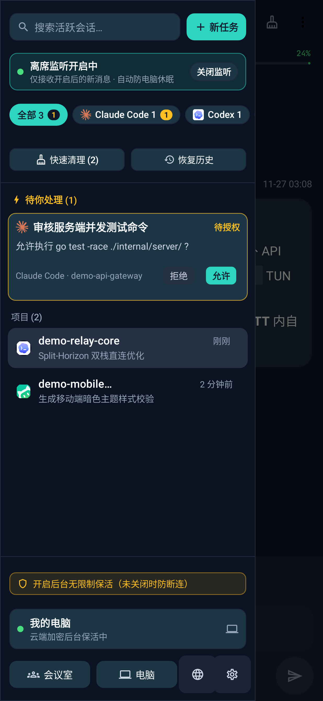

# Homing

简体中文 | [English](README.en.md)

[](https://github.com/tomato-hug/homing/actions/workflows/ci.yml)
[](https://github.com/tomato-hug/homing/actions/workflows/macos.yml)
[](https://github.com/tomato-hug/homing/actions/workflows/windows.yml)
[](https://github.com/tomato-hug/homing/releases/latest)
[](LICENSE)
[](docs/protocol.md)
[](#支持的-agent-能力分级6-主力深度集成--acp生态清单)
[](#社区交流与问题反馈)

**Every coding agent, one pocket workspace — zero VPN on your phone, zero plaintext on the relay.**

**Homing** 是一个开源的跨平台 **多 AI 编程 Agent 离席接管与协同中枢**。当你同时在开发机上运行 **Claude Code、Codex、WorkBuddy、Kimi CLI、OpenCode、ZCode** 以及支持 ACP / 目录接入的 IDE 助手时，Homing 让你在离开电脑后，仅凭一部手机（**国内 5G / Wi-Fi 直连，手机无需安装或开启任何代理**）即可在一个原生 App 内实时接收通知、审批工具调用、回复连续对话、远程唤醒未打开的 Agent，或拉起多 Agent 协同会议室。

> 当前处于公开 **Beta** 阶段：已提供 [macOS / Windows / Linux 预编译安装包与 Android APK](https://github.com/tomato-hug/homing/releases/latest) 直接下载，无需从源码编译；**iOS / iPhone 端（端到端加密 Safari PWA）** 正在规划中。安装详情与限制见 [Beta 指南](docs/beta-release.md)。

---

## 产品实机界面预览（真机截图）

<table>
  <tr>
    <th align="center">📱 手机端 · 对话优先左侧抽屉 & 跨 Agent 审批置顶</th>
    <th align="center">📱 手机端 · 实时 Markdown / Diff 与连续对话</th>
  </tr>
  <tr>
    <td align="center"></td>
    <td align="center"></td>
  </tr>
</table>

<table>
  <tr>
    <th align="center">🖥️ 桌面端 · 离席守护中心（Agent 开关 / 扫码 / 防休眠）</th>
    <th align="center">🌐 桌面端 · 双栈分流与公网/自建中继控制台</th>
  </tr>
  <tr>
    <td align="center"></td>
    <td align="center"></td>
  </tr>
</table>

---

## 为什么已有官方移动端，依然需要 Homing？

单 Agent 官方移动端已能满足单一工具的基本遥操，但只要进入**「多 Agent 并行」**或**「开发机挂代理 × 手机走国内普通网络」**的真实工况，体验就会立刻断层：

| 真实离席痛点 | 各家官方移动端方案 | 传统 SSH / Termux 终端方案 | **Homing 开源方案** |
| :--- | :--- | :--- | :--- |
| **同时使用多个 Agent** | 需在 Claude、Codex 等多个 App 间来回切换 | 需开多个 `tmux` 窗口翻屏对照 | **单 App 左侧抽屉统一接管**：6 个核心 Agent 深度对话接管 + 跨 Agent 待审批一键置顶 |
| **国内网络 × 代理开发机** | 要求**手机也常开代理/VPN**，耗电且影响微信/高德等国内应用 | 公网 SSH 暴露风险高，5G 切基站易断 | **独家「双栈分流」架构**：开发机 Agent 照常挂代理调海外模型；Homing 绕过代理直连**国内公网盲中继**，**手机纯国内 5G 零代理秒连** |
| **远程打开未启动的 Agent** | 桌面端没开就彻底失联 | 需手敲命令拉起 GUI 或进程 | **手机一键远程唤醒**（`open -g -a` 后台无感拉起桌面端或激活守护进程） |
| **代码与对话隐私安全** | 会话经过厂商云端托管 | 依赖隧道自身安全配置 | **端到端加密零知识盲中继**（`X25519 + XChaCha20-Poly1305`），1C1G 轻量云可自建，中继零明文 |
| **手机端会话噪音治理** | 历史长列表混杂，难辨真假活跃 | 无结构化卡片、无快速清理 | **后台保活 · 划掉重开自动净空**（保留电脑正在运行任务），一键清理 + 挑会话恢复最近 10 条记录 |

---

## 核心技术亮点

### 1. 国内公网盲中继 × 代理开发机「双栈分流」架构（手机零代理直连）

针对中国大陆开发者最典型的**「开发机开着 Clash / Mihomo / Surge / Sing-box 访问海外模型，但希望出门时手机直接用国内 5G 连接」**场景，Homing 从网络层解耦了**模型流量面**与**中继控制面**：

```text
                        【模型流量面 · 保持原样走代理】
                   ┌───────────────────────────────────────────┐
                   │ Mac / Windows / Linux（挂有代理 / TUN）    │
                   │   ├─ Claude Code / Codex / Gemini CLI ────┼──► 本机代理 (7890 / TUN) ──► 海外大模型 API
                   │   ├─ WorkBuddy / OpenCode / DSH / Qwen ───┼──► 国内或自定义模型 API
                   │   │                                       │
                   │   └─ Homing 守护进程 (Direct-Dial 直连引擎)│
                   └─────────────────────┬─────────────────────┘
                                         │ ① 自动隔离 HTTP_PROXY / HTTPS_PROXY 环境变量
                                         │ ② 自动检测并穿透 198.18.0.0/15 (TUN Fake-IP) 解析真实国内 IP
                                         │ ③ 出站 WSS 端到端加密长连接（开发机零公网入站端口）
                                         ▼
                           ┌───────────────────────────┐
                           │  中国大陆公网轻量云服务器  │  ◄── 官方公测节点 / 1C1G 自建 homing-server
                           │   （零知识加密盲中继）     │      仅转发密文信封，不跑模型、不落明文
                           └─────────────┬─────────────┘
                                         │ 国内骨干网低延迟 WSS (~20–40ms)
                                         ▼
                           ┌───────────────────────────┐
                           │     Android 手机客户端     │  ◄── 纯净国内 5G / Wi-Fi 直连
                           │  （零 VPN · 零代理配置）   │      切网毫秒级自动重连 1-RTT 补同步
                           └───────────────────────────┘
```

- **本机代理零干扰**：`direct_dial: true` 默认隔离 `HTTP_PROXY` / `HTTPS_PROXY`，避免国内中继绕道海外节点出现 U 型高延迟。
- **TUN Fake-IP 透明代理穿透**：当 Clash / Surge / Sing-box 开启 TUN 增强模式并返回 `198.18.0.0/15` 或 `fc00::/18` Fake-IP 时，自动向国内公共 DNS 解析真实公网 IP 并保留 TLS SNI 校验；控制台支持一键复制 Clash / Surge `DIRECT` 分流规则。
- **支持海外自建中继**：若自建中继部署在海外 VPS，可在控制台一键切回「经本机系统代理连接」。详解见 **[《中国大陆公网中继与代理网络设备部署指南》](docs/china-relay-and-proxy.md)**。

### 2. 对话优先左侧抽屉 ＋ 远程唤醒 ＋ 跨 Agent `@` 协同

- **打开即对话 + 边缘手势礼让**：左侧抽屉胶囊实时映射电脑活跃进程，未运行 Agent 自动收起；支持 **一键远程唤醒**、全局 **离席监听（PC 与手机双向同步）** 与独立防休眠开关（macOS `caffeinate` / Windows `SetThreadExecutionState`）。
- **跨 Agent 紧急审批置顶**：当一个会话跑测试、另一个 Agent 等待命令确认时，抽屉顶部置顶 **`⚡ 待你处理`** 卡片，顶栏浮现 **`待审 ›`** 瞬移胶囊，允许/拒绝后一键返回。
- **Inline `@agent` 派活与圆桌会议室（Rooms）**：可在对话内直接输入 `@codex 审查刚才的锁实现` 自动切出 Git Worktree 并行执行并回传结果，或在多 Agent 会议室中统筹讨论与行动项派发。

### 3. 端到端加密零知识盲中继（`X25519 + XChaCha20-Poly1305`）

- 电脑与手机各自在本地生成 `Ed25519` 身份与 `X25519` 协商密钥，所有会话正文、控制指令、图片与附件均在端侧密封，扫码/6 位码配对提供 **4 词 SAS 核验**防中间人劫持。
- **0-RTT 通知正文携带 & 1-RTT 恢复**：点开推送 0 毫秒展示最新回复片段；重连一次性通过单次加密 `GET /api/mobile/bootstrap` 同步全量状态。

---

## 支持的 Agent 能力分级（6 主力深度集成 + 生态清单）

我们如实区分**全链路深度接管**与**目录/ACP 协同驱动**能力，避免造成「所有工具体验完全相同」的预期落差：

| 分级与代表 Agent | 覆盖能力与边界说明 |
| :--- | :--- |
| **Tier 1 · 核心深度集成（6 个主力 Agent）**<br>**Claude Code** · **Codex** · **WorkBuddy** · **Kimi CLI** · **OpenCode** · **ZCode** | 完整连续会话流式读取、生命周期/审批 Hooks、手机端回复注入（支持排队/撤销）、模型与推理强度切换、新建/停止会话与远程唤醒。 |
| **Tier 2 · ACP 协议驱动与远程唤醒**<br>**Gemini CLI** · **Qwen Code** · **GitHub Copilot CLI** · **DSH** · **CodeBuddy** · **Cursor** · **Windsurf** · **Trae** · **Antigravity** · **Zed** · **OpenClaw** 等 | **说明**：支持桌面端/进程存活探测、手机端远程唤醒（`open -g -a` / 服务启动）以及通过 ACP 协议派发独立 `@agent` 子任务；对于不对外开放注入 API 的封闭 IDE 内部聊天窗，不支持直接向现有 IDE 聊天标签页内注水回复。 |
| **Tier 3 · 可扩展清单元数据（共 27+ 内置清单）**<br>**Kiro** · **Cline** · **Roo Code** · **Goose** · **OpenHands** · **Aider** · **Amp** · **Kilo Code** · **Junie** · **Warp** · **Droid** + 自定义 `~/.homing/agents/*.yaml` | 自动识别安装态、官方品牌矢量图标展示，并可通过本地 YAML 清单或脚本适配器自行接入任意新 CLI Agent（见 [适配器规范](docs/adapters.md)）。 |

---

## 3 分钟零编译快速开始（优先使用预编译安装包）

无需本地安装 Go、Node.js 或 Android SDK，直接下载 **[GitHub Latest Release](https://github.com/tomato-hug/homing/releases/latest)** 预编译包即可体验。

### 第一步：在开发机安装启动 Homing

| 系统平台 | 推荐安装方式（直接下载预编译包） |
| :--- | :--- |
| **macOS (Apple Silicon / Intel)** | 前往 [Latest Release](https://github.com/tomato-hug/homing/releases/latest) 下载 `Homing-*-macos-arm64.app.zip` 或 `macos-amd64.app.zip`，解压拖入 `/Applications` 打开（菜单栏托管窗口 + 防休眠）；或终端一键安装 CLI：<br>`curl -fsSL https://raw.githubusercontent.com/tomato-hug/homing/main/scripts/install.sh \| sh` |
| **Windows 10 / 11 (x64 / ARM64)** | 下载 `Homing-*-windows-amd64.zip`（含原生托盘 `Homing.exe` + `\\wsl$\` WSL2 会话穿透 + `Install-Homing.ps1`），或 PowerShell 一键安装：<br>`irm https://raw.githubusercontent.com/tomato-hug/homing/main/scripts/install.ps1 \| iex` |
| **Linux / WSL2 / 无界面服务器** | 一键安装 SHA-256 校验静态二进制并启动服务：<br>`curl -fsSL https://raw.githubusercontent.com/tomato-hug/homing/main/scripts/install.sh \| sh && homing serve --addr 127.0.0.1:18787` |

<details>
<summary>从源码自行编译电脑端（需要 Go 1.26+）</summary>

```sh
git clone https://github.com/tomato-hug/homing.git
cd homing

# macOS 桌面应用（带菜单栏托盘与窗口）：
go build -o homing ./cmd/homing && ./homing

# Linux / WSL2 / 无界面开发机：
CGO_ENABLED=0 go build -tags headless -trimpath -ldflags="-s -w" -o homing ./cmd/homing
./homing serve --addr 127.0.0.1:18787
```

</details>

启动后打开本机 **`http://127.0.0.1:18787/console`**（桌面应用会自动打开），即可进入 **离席守护中心**。

---

### 第二步：连接中继服务（开箱试玩公网节点，或 1C1G 零注册自建）

在同一局域网 Wi-Fi 下无需任何中继，直接打开守护中心扫码即可直连；若需离开电脑后用 **5G 蜂窝网络远程接管**，可任选以下一种方式：

#### 方式 A：接入官方公测公共中继（零部署 1 分钟跑通）
1. 打开官方账号中心 **[https://homing.douqu.online/account](https://homing.douqu.online/account)**，使用 GitHub 一键登录并生成电脑端密钥（`hrk_...`）。
2. 在 Homing 桌面控制台 **「连接与能力 › 中转与局域网」** 中填入地址 `wss://homing.douqu.online/v1/ws` 与 `hrk_...` 密钥，点击 **「保存并重连」**，看到绿色 **「已连接」** 即可（若开发机挂有 Clash/Surge 代理，请保持默认的 **直连模式 · 绕过本机代理**）。

> **官方公测中继透明度与免费配额说明**：
> - **公平用量限额**：普通免费账号每周 **20 小时（`1,200` 分钟手机主动交互时长）**，北京时间每周一 `00:00` 重置；**电脑常驻待机、心跳保活与向手机推送通知均不扣减时长**（日流量上限 64 MB，支持绑定 2 台电脑 / 4 台手机）。
> - **Beta 公测节点提示**：`homing.douqu.online` 当前部署于个人维护的公测机器，如需用于企业/团队长期生产环境或希望 **完全免注册、无任何时长/流量上限**，强烈建议花 3 分钟按下方「方式 B」在 1 核 1G 云主机自建（桌面端切换中继地址仅需 10 秒）。

#### 方式 B：1 核 1G 云主机自建私有盲中继（`AUTH_MODE=open` 免注册 · 无任何限额）

```sh
# 1. Docker 一键部署（监听本机 127.0.0.1:8080，前接 Caddy / Nginx TLS）
docker build -f server/Dockerfile -t homing-server .
docker run -d --name homing-server --restart unless-stopped \
  -p 127.0.0.1:8080:8080 -v homing-data:/data homing-server
```

或在 [Latest Release](https://github.com/tomato-hug/homing/releases/latest) 直接下载静态单文件 `homing-server_linux_amd64`，配合 `deploy/nginx-relay-location.conf` / Caddy 反代上线（详细步骤见 [自托管部署指南](docs/self-host.md)）。

---

### 第三步：下载安装 Android 客户端并扫码配对

- **直接下载预编译 APK（Android 8.0+，无需 Google Play / 无需源码编译）**：
  - 安装包：**[homing-android.apk（Latest Release 直链）](https://github.com/tomato-hug/homing/releases/latest/download/homing-android.apk)**
  - SHA-256 校验清单：[checksums.txt](https://github.com/tomato-hug/homing/releases/latest/download/checksums.txt)

1. 手机安装 APK 并授予通知权限（系统内的「保活引导」页已适配 ColorOS / HyperOS / OriginOS / HarmonyOS / One UI 电池白名单指引）。
2. 在电脑离席守护中心点击 **扫码**，手机端打开 Homing 扫描二维码（或输入 6 位码），核对双端 **4 个验证词** 一致后确认。
3. 手机关闭 Wi-Fi 切到 **国内纯 5G**（不挂任何 VPN），即可体验远程审批、续聊与唤醒 Agent！

<details>
<summary>从源码自行构建 Android Debug APK（需要 Android SDK & JDK 17）</summary>

```sh
cd android
./gradlew :app:testDebugUnitTest :app:assembleDebug
adb install -r app/build/outputs/apk/debug/app-debug.apk
```

</details>

---

## 平台支持矩阵与开发路线图

| 平台 | 当前状态 | 交付形态 |
| :--- | :---: | :--- |
| **macOS 13+** (Apple Silicon / Intel) | ✅ 已就绪 | 原生菜单栏托盘 `.app.zip` + `caffeinate` 防休眠守护 + CLI |
| **Windows 10 / 11** (x64 / ARM64) | ✅ 已就绪 | 原生系统托盘 `Homing.exe` + `SetThreadExecutionState` 防休眠 + `\\wsl$\` WSL2 会话穿透 |
| **Linux / WSL2 / Docker** | ✅ 已就绪 | 无图形单文件 `homing serve` + `homing tui` + `ghcr.io` 多架构容器 |
| **Android 8.0+** (Jetpack Compose) | ✅ 已就绪 | `homing-android.apk` 直装（离线同步、多国产 ROM 保活引导、文件预览） |
| **iOS / iPhone** | 🚧 **下一步优先规划** | 计划基于现有 `@homing/protocol-js` 在 `homing-server` `/app` 下内置 **端到端加密 Safari PWA**：零 App Store 审核与分发门槛，保持端到端密文直连与 Web Push 通知，国内 5G 同样零 VPN 可用 |

---

## 仓库结构与延伸文档

```text
cmd/homing/          开发机守护进程、CLI 与 Wails 跨平台桌面托盘入口
cmd/homing-server/   轻量端到端加密公网/自建盲中继服务端 (CGO_ENABLED=0 静态单文件 + SQLite)
internal/
  ├─ protocol/       Ed25519 / X25519 / XChaCha20-Poly1305 端到端协议与测试向量对齐
  ├─ cloud/          双栈代理隔离、TUN Fake-IP 穿透、并发加密 RPC 与断点补发
  ├─ agent/          6 个核心深度集成 Agent 读取、Hooks 审批与回复注入
  ├─ adapter/        27+ Agent 目录清单与自定义 YAML / 脚本适配器引擎
  ├─ driver/         ACP 协议驱动与会话生命周期控制
  ├─ orchestrator/   @agent 跨 Agent 子任务调度与 Git Worktree 隔离
  └─ api/ relayapi/  本地控制台 REST/SSE、移动端 1-RTT Bootstrap 与远程唤醒接口
console/             桌面离席守护中心与 Web 控制台 (TypeScript + Vite，中英双语)
android/             Android 原生移动端 (Kotlin + Jetpack Compose)
deploy/ scripts/     systemd、Nginx、一键安装脚手架与跨平台打包脚本
```

- **[中国大陆公网中继与代理网络设备部署指南（双栈分流详解）](docs/china-relay-and-proxy.md)**
- **[自托管中继服务、TLS 反向代理、FCM 唤醒与冒烟验收](docs/self-host.md)**
- **[macOS 原生菜单栏应用构建说明](docs/macos-native.md)** · **[端到端加密协议规范](docs/protocol.md)** · **[自定义 Agent 适配器规范](docs/adapters.md)**
- **[Beta 安装边界说明](docs/beta-release.md)** · **[贡献指南](CONTRIBUTING.md)** · **[安全边界与漏洞报告](SECURITY.md)** · **[更新日志](CHANGELOG.md)**

---

## 💬 社区交流与问题反馈

- **GitHub Discussions（架构讨论 / 许愿新 Agent / 分享自建经验）**：[进入 Discussions](https://github.com/tomato-hug/homing/discussions)
- **GitHub Issues（提交可复现 Bug 与功能建议）**：[提交 Issue](https://github.com/tomato-hug/homing/issues)
- **问题反馈与开发交流 QQ 群**：**`512365124`**（安装部署答疑、国内公网中继与分流规则配置、实测 Bug 反馈）

---

## ☕ 支持与打赏（Support & Sponsor）

Homing 坚持 **Apache-2.0 开源、无广告、端到端零知识加密**。自建中继默认免注册无限制；同时，为了方便不想购置服务器的开发者，官方公测中继提供了免费试用配额。

如果 Homing 帮你在离开电脑时省下了切 App 与配网络的麻烦，欢迎通过微信或支付宝请作者喝杯咖啡——打赏将全部用于分担公网盲中继服务器与带宽升级成本；支持者可备注 GitHub ID 或注册邮箱列入 [SPONSORS.md](SPONSORS.md) 鸣谢榜（支持匿名），并可获赠公测中继 **Sponsor 提额兑换码**。

<details>
<summary><b>👉 点击展开：微信收款码 / 支付宝收款码</b></summary>
<br>

| 微信收款码（微信扫一扫） | 支付宝收款码（支付宝扫一扫） |
| :---: | :---: |
|  |  |

</details>

---

## 🙏 致谢（Acknowledgments）

- **架构灵感**：感谢 [Magpie](https://github.com/yetone/magpie) 在单文件 Go + Wails 跨平台桌面形态上的先行探索。
- **Agent 与图标生态**：感谢 Claude Code、OpenAI Codex、WorkBuddy、OpenCode、Gemini CLI、Kimi CLI 等开放 CLI / Hook / ACP 生态，以及 [@lobehub/icons](https://github.com/lobehub/lobe-icons) 开源品牌图标库。
- **核心开源组件**：感谢 Go、`Wails`、`modernc.org/sqlite`、`coder/websocket`、`golang.org/x/crypto`、`Jetpack Compose`、`Lazysodium`、`ZXing` 以及 `JetBrains Mono`（SIL OFL 1.1）。完整致谢与赞助名单见 [SPONSORS.md](SPONSORS.md)。

---

## 开源许可

Homing 基于 [Apache License 2.0](LICENSE) 开源发布。第三方字体与开源组件保留各自原始许可证，详见 [NOTICE](NOTICE)。
